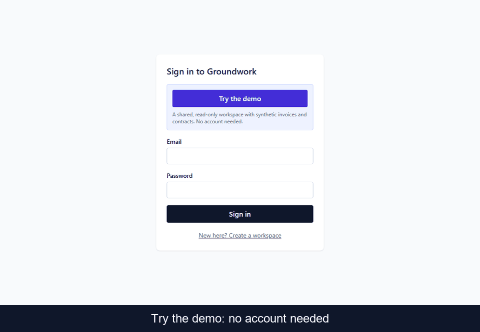
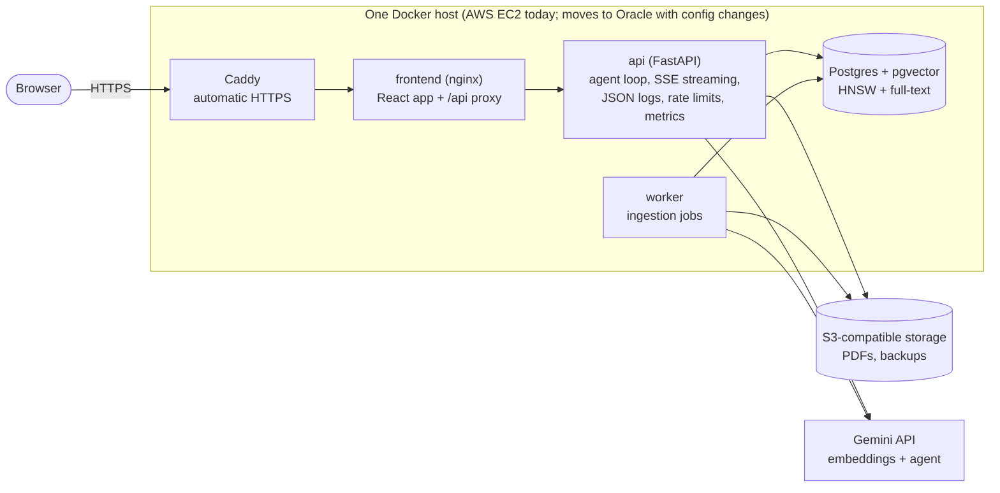

# Groundwork

**Ask questions about your invoices and contracts and get answers with citations.** A tool-calling AI
agent (FastAPI + Gemini) that combines hybrid document search with parameterised SQL over extracted
invoice and contract data, and shows exactly which page every claim came from.

**Live demo:** https://16-178-109-242.sslip.io, click **Try the demo** (no account; a shared, read-only
workspace with 25 synthetic contracts and 300 synthetic invoices). The demo has a daily question cap
to protect a free-tier API quota; if it is used up, it says so and resets the next day.

> All data here is synthetic. The corpus generator (`evals/generate_corpus.py`) has a fixed seed, so
> every question has a known correct answer, which is what makes the evaluation numbers below possible.



*Captioned frames from the live demo (a storyboard, not a recording).*

## What it does
- **Upload PDFs** (contracts, invoices). A crash-safe background worker parses, chunks, embeds and, for
  invoices and contracts, extracts structured fields (vendor, totals, payment terms, notice, renewal...).
- **Ask in plain language.** The agent chooses between `search_documents` (hybrid retrieval),
  `read_chunks`, `query_invoices` and `query_contracts` (parameterised SQL, the model never writes SQL),
  then answers with `[C1]`-style citations that open the source page and sentence.
- **See the work.** Every answer lists the tool calls that produced it, with latency.
- **Multi-tenant.** Every query is scoped by an organisation id taken from the verified token, never from
  the request or the model.

## Architecture

Details, trust boundaries and the request path: [docs/architecture.md](docs/architecture.md).

## Results (all measured; see [docs/evals.md](docs/evals.md))
Synthetic corpus, one run each, Gemini free tier. They show relative behaviour on a controlled set,
not a claim about real-world accuracy.

**Retrieval** (recall@5: the gold document *and* page is in the top 5)

| Question set | Vector only | Hybrid (vector + keyword, RRF) | Hybrid + cross-encoder rerank |
|---|---|---|---|
| Easy: 35 contract lookups | 100.0% | 97.1% | 100.0% |
| Hard: 60 (20 exact invoice numbers, 16 field lookups, 24 paraphrases) | 81.7% | **93.3%** | 78.3% |
| Hard, exact invoice-number queries only | 50% | **100%** | 70% |
| Search latency p50 | 11-13 ms | 18-36 ms | about 1.4 s |

Hybrid is the default: it fixes exact identifiers (invoice numbers) that embeddings blur. The reranker
was slower and, on this set, worse, so it is off by default (reasoning in [ADR 0005](docs/decisions/0005-keyword-search-design.md) and the journal).

**Agent** (90 questions, answers scored by rules in [ADR 0008](docs/decisions/0008-answer-scoring.md))

| Type | Answered correctly | Citation precision | Answers with a citation |
|---|---|---|---|
| Contract lookup (35) | 35/35 | 100% | **35/35** (was 26/35, [ADR 0017](docs/decisions/0017-structured-answers-carry-citations.md)) |
| Invoice aggregates (35) | 35/35 | 100% | 10/35 |
| Multi-hop (20) | 20/20 (was 6/20 before [structured contract facts](docs/decisions/0010-structured-contract-facts.md)) | n/a | 0/20 |

Every contract answer cites the page that states the fact (150 of 150 facts on all 25 contracts point at
the ground-truth page). Totals and "which vendor billed the most" are computed by the SQL tool from
extracted rows and do not point at a source document, so those answers carry no citation by design.
Latency is dominated by the model: about 9 s per question with live Gemini.

**Load and operations** (one laptop, one API process; [details](docs/evals.md#load-tests-m8))

| | Result |
|---|---|
| Search, cold (real query embedding) / warm (cached) | p95 538 ms / 24 ms at 20 req/s, 0 errors |
| Chat overhead with the demo model, 10 users | p95 190 ms, 72 req/s, 0 errors |
| Ingestion pipeline ceiling (fake AI, 1 worker) | about 2,900 pages/min |
| Tests | 373 backend (93% line coverage) + 62 frontend + 1 Playwright e2e |

## Design decisions
Short records with alternatives and reasons live in [docs/decisions/](docs/decisions/); the story of
what went wrong and how each problem was found is in [docs/journal.md](docs/journal.md).

| Decision | Why | ADR |
|---|---|---|
| Hand-written agent loop, no LangChain | Control over limits, citation validation and what each tool may return | journal |
| Hybrid search with RRF; rerank optional | Exact IDs need keywords; measured, rerank did not help here | [0005](docs/decisions/0005-keyword-search-design.md), [0006](docs/decisions/0006-search-explain-analyze.md) |
| Aggregates via SQL tools, not search | "List everything that matches" cannot be answered from top-k chunks | [0007](docs/decisions/0007-query-invoices-extensions.md), [0010](docs/decisions/0010-structured-contract-facts.md) |
| Doubtful extractions are flagged, not trusted | Wrong money figures are worse than missing ones | [0003](docs/decisions/0003-invoice-review-flag.md) |
| Postgres job queue (`SKIP LOCKED`) | No extra infra, transactional with the upload, crash-safe | journal |
| Model fallback chain, never for embeddings | Free-tier quotas are per model; vectors from different models are not comparable | [0009](docs/decisions/0009-model-fallback.md) |
| Rule-based answer scoring | Reproducible, no LLM judge | [0008](docs/decisions/0008-answer-scoring.md) |
| SSE streaming over `fetch`, plain-text answers | POST with auth header; no HTML injection from documents | [0011](docs/decisions/0011-chat-streaming-and-frontend.md) |
| In-memory limits, static admin token | One process today; upgrade path noted | [0012](docs/decisions/0012-in-memory-limits-and-admin-token.md) |
| Query-embedding cache | Saves free quota and about 450 ms per repeated question | [0013](docs/decisions/0013-query-embedding-cache.md) |
| One host, no RDS/CloudFront, portable to Oracle | The AWS free plan ends in April 2027 | [0014](docs/decisions/0014-single-host-deploy-portable-to-oracle.md), [0015](docs/decisions/0015-bundle-deploys-over-ssm.md), [migration checklist](docs/oracle-migration.md) |
| Public demo: fresh read-only user per visit, daily cap | Protects a free API quota from strangers | [0016](docs/decisions/0016-public-demo-workspace.md) |

## Run it locally (no API key needed)
```bash
AI_PROVIDER=fake docker compose up -d --build     # UI at http://localhost:8080
```
Demo mode answers with a simple document lookup so everything works offline; the UI says so. With a
Gemini key (free tier): `GEMINI_API_KEY=... docker compose up -d --build`. Development commands, tests,
evals and load tests are in [CLAUDE.md](CLAUDE.md#commands) and [loadtest/](loadtest/README.md).

## Deploy
One command per step in AWS CloudShell, no access keys and no SSH: [docs/deploy.md](docs/deploy.md).
Logs, metrics and limits: [docs/observability.md](docs/observability.md).

## Honest limitations
- Synthetic data only; the Gemini free tier may use submitted content, so never upload real documents.
- Computed answers (invoice totals, multi-hop) cite no source document; rerank is not tuned; the PDF is shown as text, not a page image.
- Contract citations find the page with search phrases tuned on the generated contracts' clause wording; messy real-world contracts may need those phrases re-tuned.
- Rate limits are per process (one API process); one host is a single point of failure, with nightly
  backups as the recovery story (restore drill passed).
- Evaluation is on templated questions over a generated corpus: a regression benchmark, not proof of
  accuracy on real documents.

## Stack
Python 3.12, FastAPI, SQLAlchemy 2 (async), Alembic, PostgreSQL + pgvector, Gemini API, PyMuPDF,
FlashRank, React 18, TypeScript, Vite, Tailwind, TanStack Query, Docker Compose, Caddy, AWS (EC2, S3,
SSM), pytest, Playwright, k6, GitHub Actions (CI).
