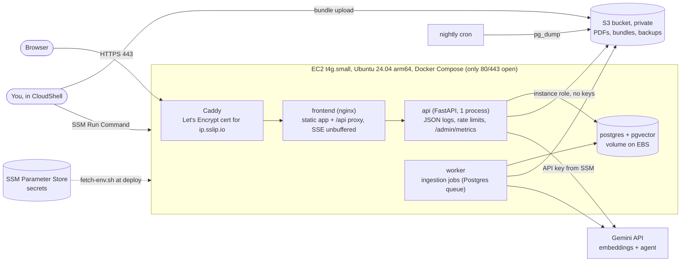

# Architecture

## Deployed (M9): one Docker host, AWS now, Oracle later

| Piece | What it is | Why |
|---|---|---|
| Caddy | reverse proxy, automatic HTTPS | free certificate, no domain to buy (sslip.io hostname) |
| frontend | nginx serving the built React app, proxying `/api` | same origin, no CORS; strict CSP |
| api / worker | the Python backend image, two commands | one image, one process each (limiter is per process, ADR 0012) |
| postgres | `pgvector/pgvector:pg16` container | no RDS: portable, cheaper (ADR 0014) |
| S3 | real object storage via boto3 and the instance role | PDFs; also deploy bundles and DB dumps |
| SSM Parameter Store | secrets (SecureString) | never in git or on a laptop |
| SSM Run Command | how deploys run on the instance | no SSH port, no keys (ADR 0015) |

Trust boundaries: the internet only reaches Caddy. The API and database are on the internal Compose
network. Tenant isolation is enforced in the application (every query takes `org_id` from the verified
token). The instance role can read `/groundwork*` parameters and use one bucket, nothing else.

## Local development
`docker-compose.yml`: Postgres, RustFS (S3-compatible), api, worker, frontend on 127.0.0.1 ports. The
fake provider runs the whole app without a key (`AI_PROVIDER=fake`).

## Request path (chat)
Browser -> Caddy -> nginx -> `POST /chat/{id}/messages` (JWT, per-org rate limit, concurrency slot) ->
agent loop (tools: search, read, query invoices, query contracts; hybrid retrieval over pgvector +
full-text) -> Gemini -> citation-validated answer streamed back as Server-Sent Events.
